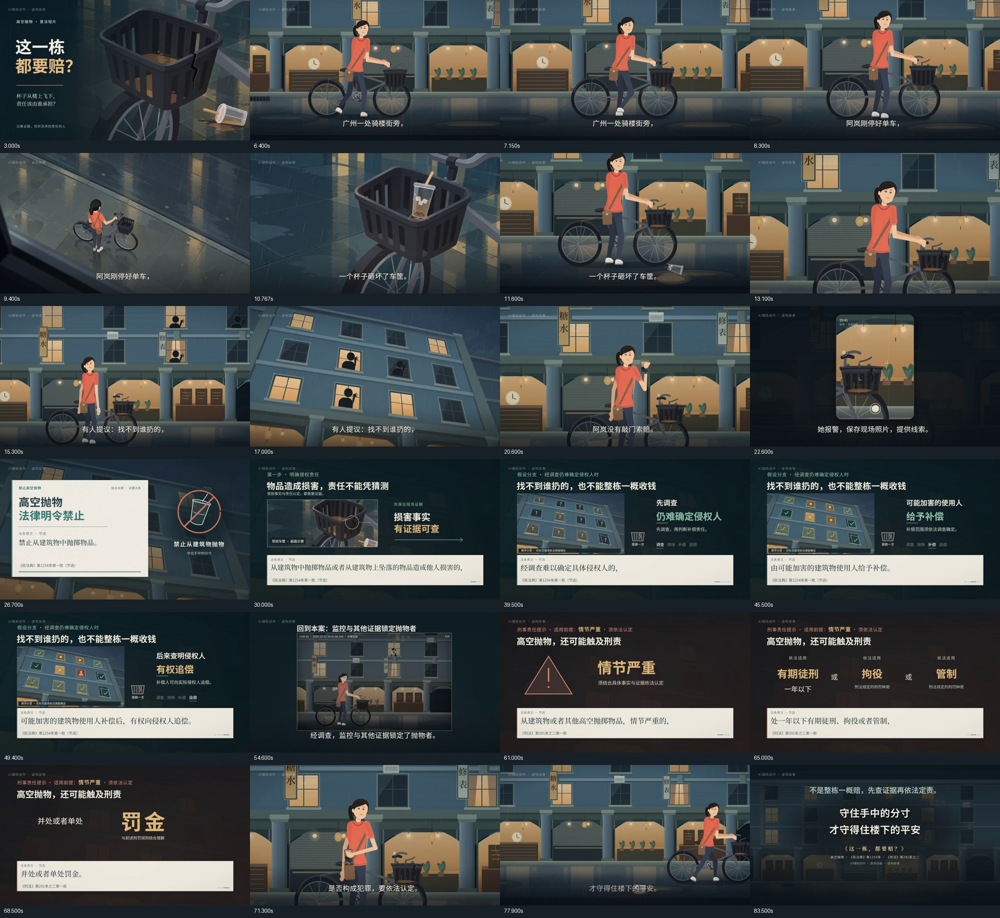

# 《这一栋，都要赔？》Remotion 普法动画

广州骑楼街场景的 AI 辅助普法二维动画工程。
Remotion 4.0.537 + React 19；1920×1080 / 60fps / 84 秒（5040 帧）。

当前完整审看版：**v23**，`out/这一栋都要赔_二维动画_1080P60_v23.mp4`，84秒、1080p60。已纠正v22推车人物双腿分跨车架的遮挡错误，统一人物站在自行车同一侧。[修正与实际成片验证](docs/V23-SAME-SIDE.md) · [五维审查](docs/V22-PREFLIGHT.md)。

下载成片、SHA256校验及实际修改对照：[v23发布页](https://github.com/antisali996-dot/guangzhou-law-ai-2026-remotion/releases/tag/film-v23)。仓库保持私有，访问和下载需要仓库权限。

上一版本地成片：`out/这一栋都要赔_二维动画_1080P60_v21.mp4`。[v21复审与验收](docs/V21-VERIFICATION.md) · [设计与五维复审](docs/V21-REVIEW-PLAN.md)。

历史重点段预览：`out/法条与取证优化预览_v21.mp4`（38.7–59.5秒，960×540）。[v20皱眉修正](docs/V20-VERIFICATION.md) · [v19多机位](docs/V19-DESIGN.md) · [v18优化](docs/V18-DESIGN.md)。

已归档的 v16 完整成片和 22.5 秒修复预览见 [film-v16 发布页](https://github.com/antisali996-dot/guangzhou-law-ai-2026-remotion/releases/tag/film-v16)。[v16 验收记录](docs/V16-VERIFICATION.md)。



## 获取与运行（Windows）

当前验证环境为 Node.js 24、Python 3.12.5、本机 Chrome 和 FFmpeg。

```powershell
git clone https://github.com/antisali996-dot/guangzhou-law-ai-2026-remotion.git
cd guangzhou-law-ai-2026-remotion
npm ci
python -m pip install -r requirements.txt
npm run studio
```

Chrome 默认位置在 `remotion.config.ts`；更换电脑时请按本机安装路径调整 `Config.setBrowserExecutable(...)`。
音频工具的 FFmpeg / ffprobe 路径位于 `work/audio/timeline_audio.py`，默认是 `D:\dshws\tools\ffmpeg\bin`，请按本机安装位置调整 `FF` / `PROBE` 后再混音、验收或导出。

仓库包含预览和渲染所需的本地字体、旁白、配乐、音效和已生成的美术资源；无需在线生成素材。`node_modules`、渲染缓存、调试备份和视频不进入 Git；成片通过Release附件提供。v23附件名为 `film-v23-1080p60.mp4`，如需使用工程中的成片核查命令，将其保存为 `out/这一栋都要赔_二维动画_1080P60_v23.mp4`。v22保留为本地问题对照。
素材来源及字体许可见 [THIRD_PARTY.md](THIRD_PARTY.md)。

## 维护入口

- `src/Root.tsx`：主片 Film，以及动作和环境自检合成。
- `src/film/timeline.ts`：13 个分镜的起止时间。
- `src/film/cameraAngles.ts`、`AngleShots.tsx`：事件内的多机位时间、杯子近景投影、窗口人物与手机屏幕合成。
- `src/film/legalFlow.ts`、`scenes/LegalStory.tsx`：责任分支、法条引用、窗口证据图解与刑责条件。
- `src/film/vo.ts`：11 段旁白、字幕和引用标签。
- `src/film/cues.ts`：17 个音效时刻与唯一的配乐增益；预览、混音和验收共同读取。
- `src/film/cctv.ts`：监控回放的事件时间、人物、共享杯子轨迹、时间码及显式定格。
- `src/film/geometry.ts`：人物、单车和地面的共同坐标。
- `src/film/leave.ts`：片尾重新握把、收脚架、持续推车和镜头落后；离场落脚时刻也由这里生成。
- `src/film/stowPhone.ts`：手机取出、收纳及包口开合；共用固定包口遮挡和手腕坐标。
- `src/characters/Rig.tsx`：人物骨骼、肩部、包体及包口坐标。
- `src/characters/locomotion.ts`：落脚约束步态。
- `work/audio/`：时间线导出、混音、响度归一、成片验收和完整导出入口。
- `work/checks/`：持续维护的动作与音频回归检查，属于工程工具。
- `out/`：正式成片；旧版保留，导出入口拒绝覆盖已存在的成片。

## 使用

在工程目录打开终端：

```powershell
npm run studio
npm run typecheck
npm test
```

导出下一版完整成片（指定一个尚不存在的文件名）：

```powershell
npm run render:final -- --output "out/这一栋都要赔_二维动画_1080P60_v24.mp4"
```

此命令执行：检查 → 按源码混音 → 28 条声音对时 → 两遍响度归一 → Remotion 全尺寸渲染 → 封装 → 检查实际交付文件。
运行资料和日志保存在 `work/render-时间戳/`。源码、public 素材或音频工具若在渲染期间发生变化，会停止封装，避免混用版本。

仅作开发预览：

```powershell
npm run render:film
npm run mix
python -B work/audio/check_mp4.py "out/需要检查的文件.mp4" --report work/mp4-report.json
```

`render:film` 的原始音轨尚未归一到交付响度；正式交付使用 `render:final`。

## 声音验收

- 时间线通过 `export-timeline.cjs` 直接求值 TypeScript 导出，不再用正则解析或写死旧时刻。
- 声音起点按 60fps 量化，与 Remotion Sequence 使用相同帧边界。
- `check_timing.py` 检查当前 11 段旁白、17 个音效；先确认旁白，再扣除已识别的人声以检查较轻的音效，不通过降低置信度阈值放行。
- `check_mp4.py` 必须明确指定文件，检查规格、完整解码、持续黑场、实际音轨响度及 11 段旁白、17 个音效起点。
- 默认目标 −16 LUFS，真峰值上限 −1.5 dBTP。最终验收允许编码误差，并保留实测值。
- 本轮没有进行人工主观听审。

## 约定与环境

- 修改分镜从 `timeline.ts` 开始；修改声音从 `cues.ts` / `vo.ts` 开始。
- 人物与单车相对位置由 `BIKE` 几何派生，当前 `BIKE_DX=14`；车轮旋转统一使用 `wheelRotationFor`。
- 杯子轨迹与落地姿态来自 `alan.ts` 的 `cupAt` / `CUP_REST`，后续镜头和监控回放共享，撞击点从受损篮沿派生；落杯与茶渍共用 `CUP_GROUND_Y`，位于通行平面前方。
- 手机与包体共用 `bagPointFor` 坐标转换；不得再通过缩短手机尺寸或透明度表示入包。
- 持续离场使用 `finishAtRest: false`，不得强制并脚收步；S11 先握把、收架，再前进。镜头逐渐落后，行走中切片尾。
- 杯子剩余量越少，液面越低；冰块随液面移动，液体裁切在杯体内。
- Node 24、本机 Chrome；FFmpeg 位于 `D:\dshws\tools\ffmpeg\bin`。
- Root 接入本地 Noto 字体加载器；字体加载并注册成功后才解除渲染等待。验证日志见 `fonts-ready.json`。
- 旁白生成依赖相邻 v3 工程的原始 voice.json；已有 WAV 可直接用于渲染。
- v15 已对照官方公开文本核对《民法典》第1254条第一款和《刑法》第291条之二第一款，明确节选范围；出处和处理见 [法条核对记录](docs/LAW-REVIEW.md)。
- 本轮未核验全部素材及配音授权链，未重新生成现有旁白。

## 静帧检查

```powershell
node work/checks/render-stills.cjs work/stills-check 646 1368 2460 3840 4860
```

该命令使用官方 renderStill API，导出关键帧及字体就绪记录。当前 Windows 环境使用稀疏 --frames 列表导出会触发音频写入错误，因此静帧检查使用此入口。
